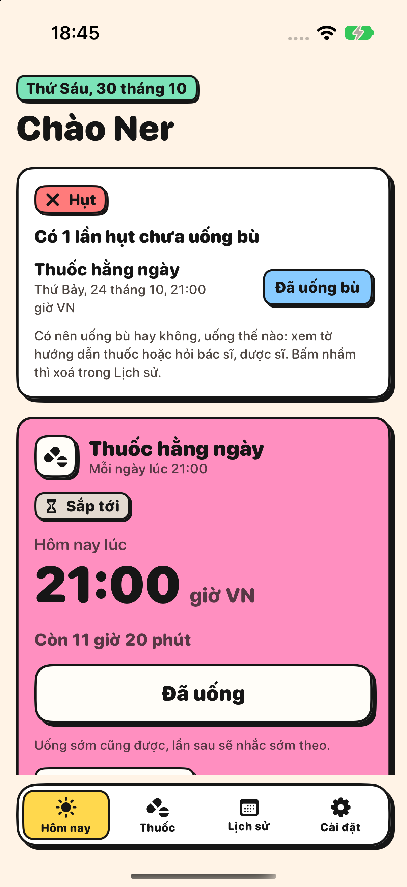
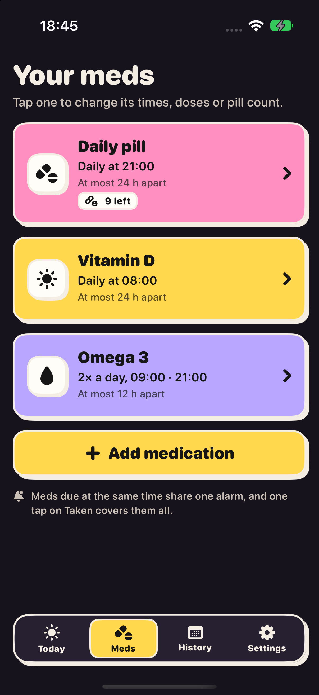
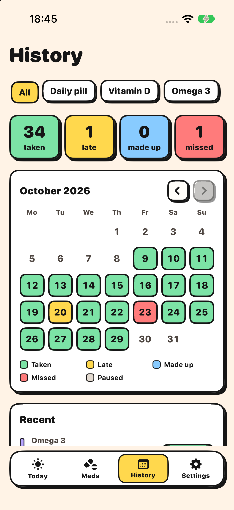

<p align="center">
  
</p>

<h1 align="center">Pillot</h1>

<p align="center">
  Nhắc uống thuốc dễ thương, luôn đúng giờ Việt Nam dù bạn đang bay tới múi giờ nào.<br>
  <em>A cute medication reminder that always runs on Vietnam time, wherever you fly.</em>
</p>

<p align="center">
  <a href="https://github.com/finnwasabi/pillot/actions/workflows/ci.yml"></a>
  <a href="https://github.com/finnwasabi/pillot/releases/latest"></a>
  
  <a href="LICENSE"></a>
</p>

<p align="center">
  
  
  
</p>

<p align="center"><a href="#english">English below</a></p>

## Tiếng Việt

Mình làm Pillot cho bạn gái, một tiếp viên hàng không: múi giờ đổi liên tục, nhưng giờ uống thuốc thì không được xê dịch.
App giữ lịch theo giờ Việt Nam, báo thức kêu cả khi máy im lặng, và không cần mạng. Mã nguồn mở, ai cần cứ cài và dùng.

### Có gì

- **Nhiều loại thuốc.** Mỗi thuốc có tên, màu, biểu tượng, giờ uống, 1 tới 6 lần mỗi ngày, khoảng cách tối đa, số viên và ngày nghỉ riêng.
- **Luôn giờ Việt Nam.** Mọi mốc là thời điểm tuyệt đối, đổi múi giờ không làm lệch. Màn hình hiện cả giờ nơi đang đứng.
- **Báo thức thật (AlarmKit).** Kêu cả khi gạt im lặng hay bật Focus. Thuốc trùng giờ báo chung một chuông.
- **Nhắc tới khi uống.** Nhắc lại, dồn dập trước hạn chót, quá hạn vẫn nhắc. Hoãn 9 phút như Đồng hồ iPhone (chỉnh 1 tới 15), chỉ "Đã uống" hoặc "Bỏ qua lần này" mới tắt.
- **Trễ, hụt, uống bù, bỏ qua.** Bỏ qua có chủ đích không tính là hụt.
- **Ngày nghỉ theo chu kỳ**, ví dụ 21 ngày uống, 7 ngày nghỉ: ngày nghỉ không nhắc, không tính hụt.
- **Đếm viên theo vỉ**, thêm 1 vỉ một chạm, nhắc mua thêm khi sắp hết.
- **Sao lưu và khôi phục** ra một file, cất vào iCloud Drive, Google Drive hay đâu tuỳ bạn.
- **Widget** màn hình chính và màn khoá, **Shortcuts** "I took my meds".
- **Không cần mạng.** Có mạng thì gửi trạng thái lên dịch vụ tự host để người thân theo dõi qua bot Telegram riêng, bot còn nhắc khi quá hạn chót mà chưa thấy uống. Mỗi server chỉ phục vụ một người dùng và một chat Telegram: muốn dùng tính năng này thì tự dựng server theo [server/](server/README.md).
- **Tiếng Việt và tiếng Anh**, sáng và tối, giao diện neubrutalism pastel.

### Cài đặt

Cần iOS 26 trở lên và [SideStore](https://sidestore.io) (Apple ID miễn phí là đủ).
Trong SideStore: **Sources**, nút **+**, dán địa chỉ dưới đây rồi cài Pillot. Có bản mới thì SideStore tự báo.

```
https://github.com/finnwasabi/pillot/releases/latest/download/source.json
```

Đã thêm source cũ (`ners-daily` hay `medly`) thì vẫn chạy nhờ GitHub tự chuyển hướng, nhưng nên đổi sang địa chỉ trên.

### Phát triển

- Xcode 26 trở lên và [XcodeGen](https://github.com/yonaskolb/XcodeGen): `xcodegen generate` rồi mở `Pillot.xcodeproj`.
- Logic lịch nhắc nằm ở `Packages/PillotCore` (Swift thuần, có test): `swift test --package-path Packages/PillotCore`.
- Dịch vụ đồng bộ và bot: [server/](server/README.md). Đặc tả logic và hợp đồng dữ liệu: [docs/spec.md](docs/spec.md).
- Muốn đóng góp: đọc [CONTRIBUTING.md](CONTRIBUTING.md). Lỗi bảo mật: [SECURITY.md](SECURITY.md).

App chỉ nhắc giờ, không đưa lời khuyên y khoa. Uống thế nào, uống bù hay bỏ qua ra sao: xem tờ hướng dẫn thuốc hoặc hỏi bác sĩ, dược sĩ.

## English

I built Pillot for my girlfriend, a flight attendant: the time zone changes all the time, but her doses must not drift.
It keeps the schedule on Vietnam time, rings even on silent, and works offline. It is open source, so anyone who needs it is welcome to use it.

### Features

- **Several medications.** Each has its own name, color, icon, time, 1 to 6 doses a day, maximum gap, pill count and days off.
- **Always Vietnam time.** Every reminder is an absolute moment, so changing time zones never shifts it. Screens also show the local time.
- **Real alarms (AlarmKit).** They ring on silent and in Focus. Medications due together share one alarm.
- **Reminds until taken.** Repeats, a faster cadence before the deadline, and it keeps going after it. Snooze is 9 minutes like the iPhone Clock (1 to 15); only Taken or Skip this dose stops it.
- **Late, missed, made up, skipped.** A dose skipped on purpose does not count as missed.
- **Days off in a cycle**, such as 21 on and 7 off: nothing rings and nothing counts as missed on days off.
- **Pill counting by pack**, one-tap Add a pack, and a refill reminder when it runs low.
- **Backup and restore** to a file you keep wherever you like: iCloud Drive, Google Drive or anywhere else.
- **Widgets** for the home and lock screen, and a **Shortcut**: "I took my meds".
- **Offline first.** When online, the latest status goes to a self-hosted service so someone you trust can follow along through a private Telegram bot, which also nudges them when a deadline passes with no dose reported. Each server serves one user and one Telegram chat, so using this means running your own (see [server/](server/README.md)).
- **Vietnamese and English**, light and dark, in a pastel neubrutalist look.

### Install

Requires iOS 26 or later and [SideStore](https://sidestore.io) (a free Apple ID is enough).
In SideStore: **Sources**, **+**, paste the address below and install Pillot. SideStore picks up new versions automatically.

```
https://github.com/finnwasabi/pillot/releases/latest/download/source.json
```

The old `ners-daily` and `medly` sources still work through GitHub's redirect, but switching to this address is better.

### Development

- Xcode 26 or later and [XcodeGen](https://github.com/yonaskolb/XcodeGen): run `xcodegen generate`, then open `Pillot.xcodeproj`.
- The scheduling logic lives in `Packages/PillotCore` (pure Swift, tested): `swift test --package-path Packages/PillotCore`.
- Sync service and bot: [server/](server/README.md). Logic and data contract: [docs/spec.md](docs/spec.md).
- Contributing: see [CONTRIBUTING.md](CONTRIBUTING.md). Security issues: [SECURITY.md](SECURITY.md).

The app only keeps time. It gives no medical advice: for how to take, make up or skip a dose, check the leaflet or ask a doctor or pharmacist.

## Roadmap

See the [open issues](https://github.com/finnwasabi/pillot/issues) and the [changelog](CHANGELOG.md). Ideas and pull requests are welcome.

## License

[MIT](LICENSE) © Lê Nhật Tùng
