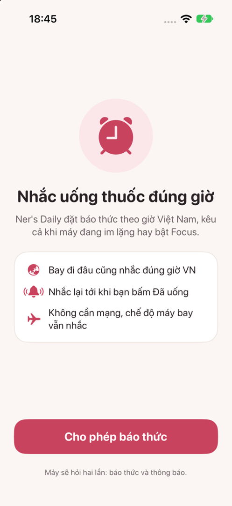
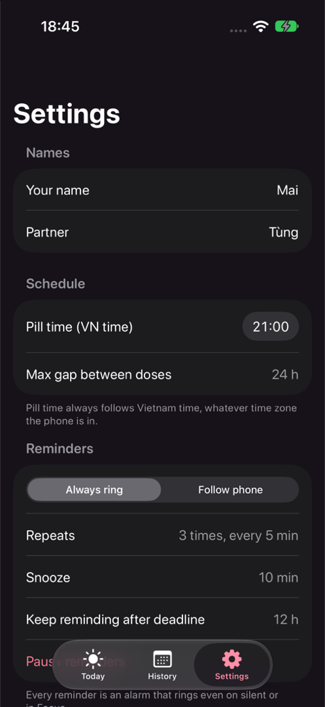

<p align="center">
  
</p>

<h1 align="center">Ner's Daily</h1>

<p align="center">
  Nhắc uống thuốc hằng ngày, luôn đúng giờ Việt Nam dù bạn đang bay tới múi giờ nào.<br>
  <em>A daily pill reminder that always runs on Vietnam time, wherever you fly.</em>
</p>

<p align="center">
  <a href="https://github.com/finnwasabi/ners-daily/actions/workflows/ci.yml"></a>
  <a href="https://github.com/finnwasabi/ners-daily/releases/latest"></a>
  
  <a href="LICENSE"></a>
</p>

<p align="center">
  
  
  
</p>

<p align="center"><a href="#english">English below</a></p>

## Tiếng Việt

Làm cho một người hay bay: đổi múi giờ liên tục nhưng thuốc thì không được cách nhau quá 24 giờ.
Ner's Daily giữ lịch theo giờ Việt Nam, báo thức kêu cả khi máy im lặng, và không cần mạng.

### Có gì

- **Luôn giờ Việt Nam.** Mọi mốc là thời điểm tuyệt đối, đổi múi giờ máy không làm lệch. Màn hình hiện cả giờ nơi đang đứng.
- **Báo thức thật (AlarmKit).** Kêu cả khi gạt im lặng hay bật Focus. Hoặc chọn chế độ theo máy, riêng hạn chót luôn kêu.
- **Nhắc tới khi uống.** Nhắc lại, dồn dập trước hạn chót 24 giờ, quá hạn vẫn nhắc tiếp. Hoãn có đếm ngược trên màn khoá.
- **Trễ, hụt và uống bù.** Uống sau hạn chót tính trễ, quá 12 giờ tính hụt, đánh dấu được uống bù cho viên hụt.
- **Đếm viên (tuỳ chọn).** Trừ mỗi lần uống, nhắc mua vỉ mới khi còn ít.
- **Không cần mạng.** Có mạng thì gửi trạng thái lên dịch vụ tự host để partner theo dõi qua bot Telegram riêng.
- **Tiếng Việt và tiếng Anh**, chế độ sáng và tối.

### Cài đặt

Cần iOS 26 trở lên và [SideStore](https://sidestore.io) (Apple ID miễn phí là đủ).
Trong SideStore: **Sources**, nút **+**, dán địa chỉ dưới đây rồi cài Ner's Daily. Có bản mới thì SideStore tự báo.

```
https://github.com/finnwasabi/ners-daily/releases/latest/download/source.json
```

### Phát triển

- Xcode 26 trở lên và [XcodeGen](https://github.com/yonaskolb/XcodeGen): `xcodegen generate` rồi mở `NersDaily.xcodeproj`.
- Logic lịch nhắc nằm ở `Packages/NersCore` (Swift thuần, có test): `swift test --package-path Packages/NersCore`.
- Dịch vụ đồng bộ và bot: [server/](server/README.md). Đặc tả logic và hợp đồng dữ liệu: [docs/spec.md](docs/spec.md).
- Muốn đóng góp: đọc [CONTRIBUTING.md](CONTRIBUTING.md). Lỗi bảo mật: [SECURITY.md](SECURITY.md).

App chỉ nhắc giờ, không đưa lời khuyên y khoa. Uống thế nào, uống bù ra sao: xem tờ hướng dẫn thuốc hoặc hỏi bác sĩ, dược sĩ.

## English

Built for someone who flies for work: the time zone changes all the time, but two doses must never be more than 24 hours apart.
Ner's Daily keeps the schedule on Vietnam time, rings even on silent, and works offline.

### Features

- **Always Vietnam time.** Every reminder is an absolute moment, so changing the phone's time zone never shifts it. Screens also show the local time.
- **Real alarms (AlarmKit).** They ring on silent and in Focus. Or follow the phone's mode, except that the deadline always rings.
- **Reminds until taken.** Repeats, then a faster cadence before the 24-hour deadline, and it keeps going after it. Snooze shows a lock screen countdown.
- **Late, missed and made up.** A dose after the deadline counts as late, after 12 more hours as missed, and a missed pill can be marked as made up.
- **Pill counting (optional).** One pill per dose, with a refill reminder when the pack runs low.
- **Offline first.** When online, the latest status goes to a self-hosted service so a partner can follow along through a private Telegram bot.
- **Vietnamese and English**, light and dark mode.

### Install

Requires iOS 26 or later and [SideStore](https://sidestore.io) (a free Apple ID is enough).
In SideStore: **Sources**, **+**, paste the address below and install Ner's Daily. SideStore picks up new versions automatically.

```
https://github.com/finnwasabi/ners-daily/releases/latest/download/source.json
```

### Development

- Xcode 26 or later and [XcodeGen](https://github.com/yonaskolb/XcodeGen): run `xcodegen generate`, then open `NersDaily.xcodeproj`.
- The scheduling logic lives in `Packages/NersCore` (pure Swift, tested): `swift test --package-path Packages/NersCore`.
- Sync service and bot: [server/](server/README.md). Logic and data contract: [docs/spec.md](docs/spec.md) (Vietnamese).
- Contributing: see [CONTRIBUTING.md](CONTRIBUTING.md). Security issues: [SECURITY.md](SECURITY.md).

The app only keeps time. It gives no medical advice: for how to take or make up a pill, check the leaflet or ask a doctor or pharmacist.

## Roadmap

See the [open issues](https://github.com/finnwasabi/ners-daily/issues) and the [changelog](CHANGELOG.md). Ideas and pull requests are welcome.

## License

[MIT](LICENSE) © Lê Nhật Tùng
